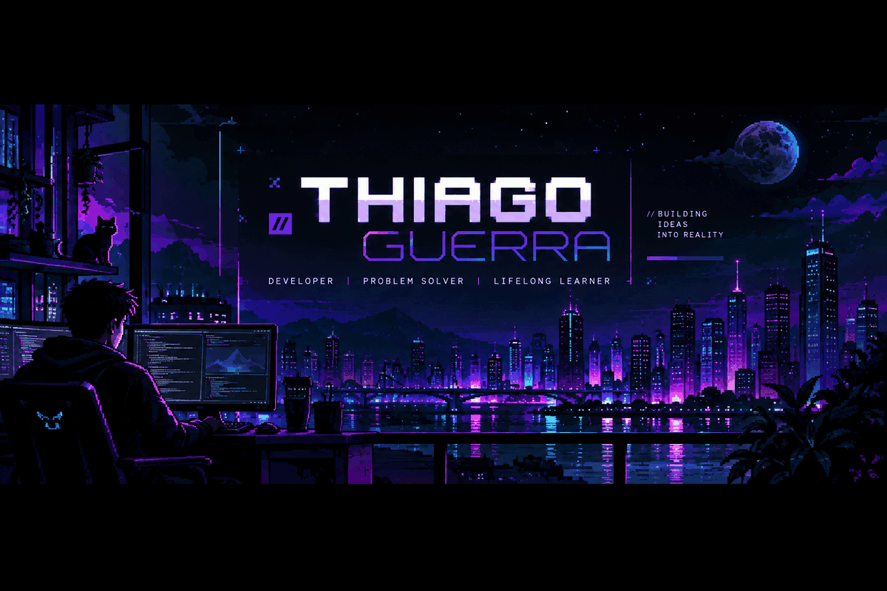
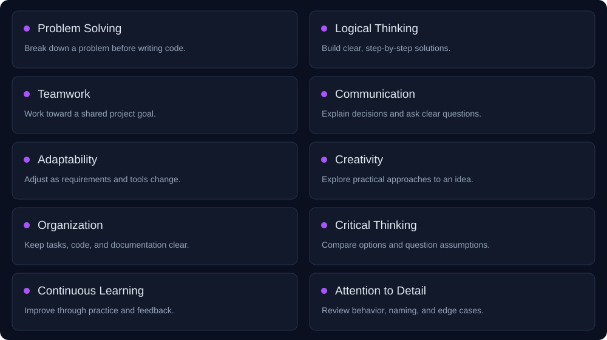

  
  

  <a href="#about-me">About</a> · <a href="#tech-stack">Tech Stack</a> · <a href="#contribution-snake">Contributions</a> · <a href="#connect-with-me">Connect</a>

## About Me

I'm **Thiago Guerra**, a software development student interested in understanding how technology can solve everyday problems. I'm building my programming foundations through coursework, individual exercises, and collaborative projects.

My public work includes a product management application with JavaScript and Express, a memory game developed with Python and Pygame, and Java exercises focused on modeling objects and their relationships. These projects help me connect programming concepts with practical decisions about code, behavior, and usability.

I'm working toward becoming a more thoughtful and dependable developer: writing clearer code, testing assumptions, documenting decisions, and learning from feedback. My goal is to keep building useful projects while developing stronger skills in backend development and software design.

## Soft Skills

The professional habits I'm developing alongside my technical skills:

## Hard Skills

| Area | Practiced in public projects | Learning focus |
| --- | --- | --- |
| **Programming Fundamentals** | Programming logic, algorithms, and organizing application behavior through Python and JavaScript projects. | Data structures, algorithm selection, systematic debugging, and testing. |
| **Software Development** | Java exercises with classes, objects, and collections. Python modules and game logic in a group project. | Encapsulation, inheritance, polymorphism, and exception handling. |
| **Web Development** | HTML, CSS, vanilla JavaScript, Node.js, and Express in a product CRUD application. A Postman collection accompanies the project. | HTTP fundamentals, REST API design, validation, error handling, and backend structure. |
| **Development Tools** | GitHub repositories and a Java project organized with Maven. | Git workflows, code review habits, and an efficient Visual Studio Code workflow. |

These categories describe practical exposure and study goals, rather than advanced proficiency.

## Tech Stack

### Programming Languages

   &nbsp;
   &nbsp;
  

**Java · JavaScript · Python**

### Web Technologies

   &nbsp;
   &nbsp;
   &nbsp;
   &nbsp;
  

**HTML5 · CSS3 · Node.js · Express.js · React**

### Tools & Platforms

   &nbsp;
   &nbsp;
   &nbsp;
  

**Git · GitHub · Visual Studio Code · IntelliJ IDEA**

## Currently Learning

| Focus | What I'm working toward |
| --- | --- |
| **◈ Java & Object-Oriented Programming** | Building confidence with object relationships, encapsulation, collections, exceptions, inheritance, and polymorphism before moving into advanced Java topics. |
| **◇ Data Structures & Algorithms** | Choosing appropriate structures and understanding how solution design affects clarity and performance. |
| **◈ Backend Development** | Developing stronger Node.js and Express foundations, designing RESTful APIs, and understanding HTTP behavior. |
| **◇ Software Design & Architecture** | Learning to separate responsibilities and organize small applications into maintainable components. |

## GitHub Statistics

  

<b>Most Used Languages</b>

  

Language statistics reflect repository content, not proficiency.

**[Contributions & daily activity ↗](https://github.com/thiagoguerra-199?tab=overview)**

Live statistics are provided by an external service. My GitHub profile is the source for current contributions.

## Achievements

A growing portfolio built through practical coursework:

- **Web development:** a product CRUD application with a browser interface and Express backend.
- **Collaborative development:** participation in the Match Memory group project.
- **Java foundations:** ongoing practice with domain modeling and object-oriented programming.

Project milestones, without claims of professional experience or certifications.

## Contribution Snake

  

Real contributions. One commit at a time.

## Connect With Me

  

Learning with purpose. Building with care.

