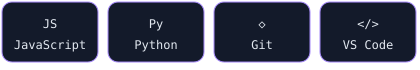

### Sobre mim · About me
Olá! Sou **Thiago Guerra**. [Escreva aqui sua área, interesses e objetivo.]
Hello! I'm **Thiago Guerra**. [Write your field, interests and goal here.]

### Ferramentas · Toolkit
<!-- Exemplos: remova tecnologias que você ainda não usa. -->

### Aprendendo · Learning
- [Tecnologia que você está estudando / Technology you are learning]
- [Seu próximo objetivo / Your next goal]

### Projetos em destaque · Featured projects
| Projeto / Project | Descrição / Description |
| --- | --- |
| [PROJETO_1](https://github.com/thiagoguerra-199/PROJETO_1) | [Problema resolvido e tecnologias / Problem solved and stack] |
| [PROJETO_2](https://github.com/thiagoguerra-199/PROJETO_2) | [Problema resolvido e tecnologias / Problem solved and stack] |

### Atividade · Activity

### Conquistas · Achievements

### Snake

### Pac-Man

### Vamos conversar · Connect
[GitHub](https://github.com/thiagoguerra-199) · [LinkedIn](https://www.linkedin.com/in/Thiago Guerra/) · [Email](mailto:thiagoguerra199@gmail.com)
